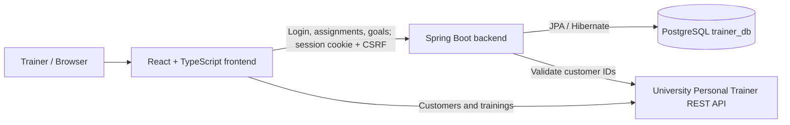
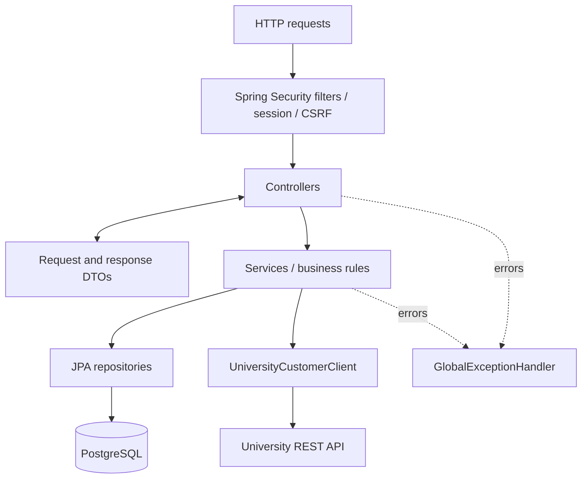
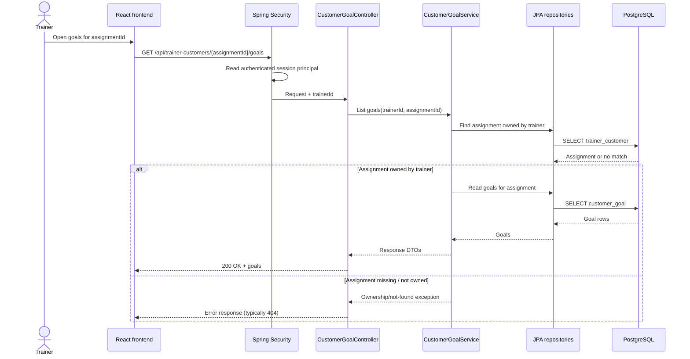
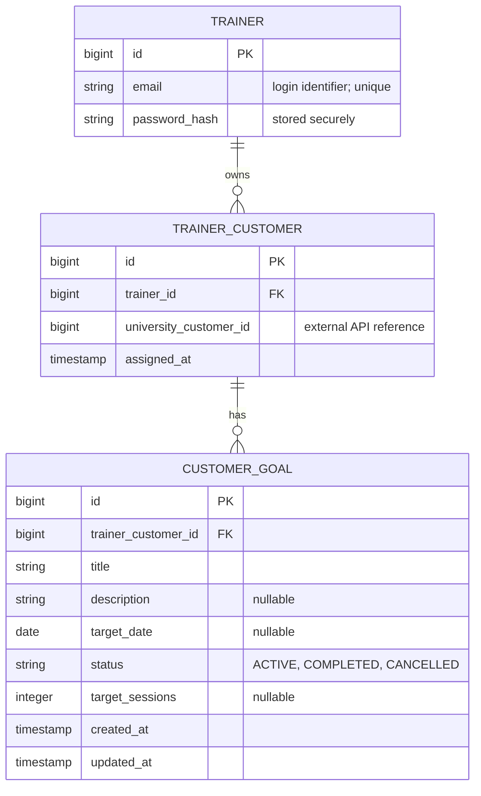
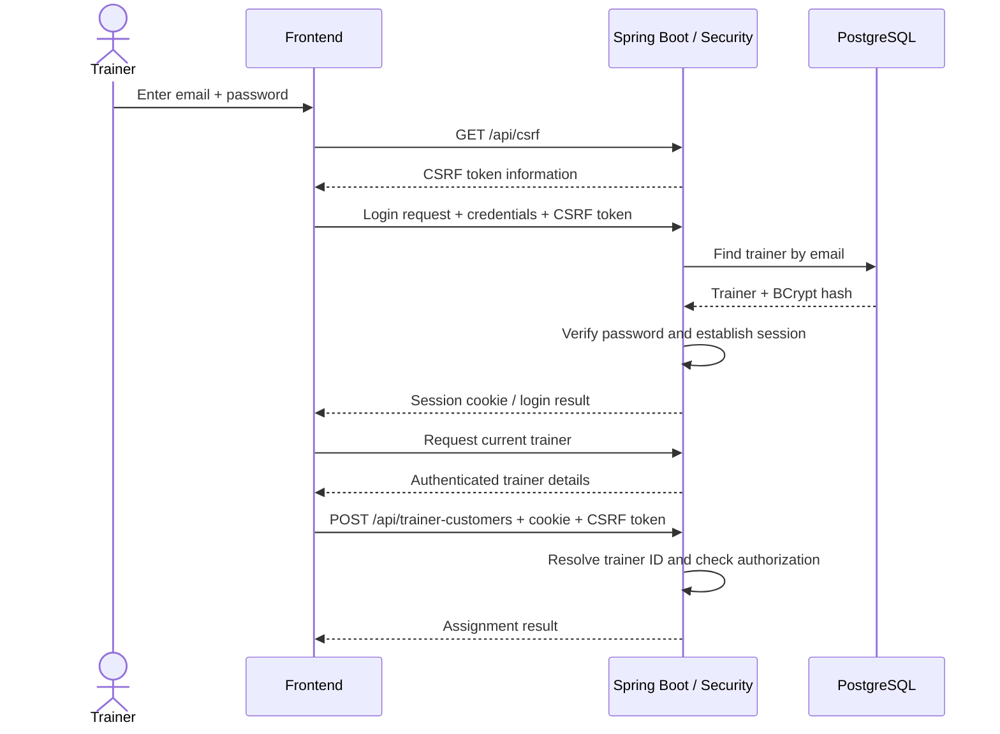

# Backend — Personal Trainer Management System

Spring Boot REST API for trainer authentication, private customer assignments, and fitness-goal management. This backend is one part of the full-stack project; see the [root README](../README.md) for the frontend, full-stack setup, and project scope.

> **Scope and source of truth:** This documentation reflects the backend features and project configuration established during development. Some exact property names, Java package paths, and authentication route strings have not been re-verified against the latest repository checkout. Before merging, compare those details with `src/main/resources/application.properties`, the controllers, `pom.xml`, and the root `compose.yaml`. The diagrams are logical documentation, not a reverse-engineered schema dump.

## Contents

1. [Responsibilities and technology](#responsibilities-and-technology)
2. [System architecture](#system-architecture)
3. [Backend design and request lifecycle](#backend-design-and-request-lifecycle)
4. [Database design and ER diagram](#database-design-and-er-diagram)
5. [Flyway migration history](#flyway-migration-history)
6. [Security and session authentication](#security-and-session-authentication)
7. [REST API reference](#rest-api-reference)
8. [Local development setup](#local-development-setup)
9. [External university REST API](#external-university-rest-api)
10. [Validation and error handling](#validation-and-error-handling)
11. [Testing and CI](#testing-and-ci)
12. [Troubleshooting](#troubleshooting)
13. [Design decisions and limitations](#design-decisions-and-limitations)

## Responsibilities and technology

The backend owns the data and rules that must be private to each trainer:

- Register trainer accounts and authenticate with email and password.
- Create and maintain Spring Security sessions; provide a CSRF-token endpoint.
- Store trainer-to-university-customer assignments.
- Store fitness goals associated with each assignment.
- Enforce ownership on assignment and goal operations using the authenticated trainer ID.
- Verify university customer existence when assigning a customer.
- Validate requests and return meaningful HTTP error responses.
- Maintain the PostgreSQL schema using versioned Flyway migrations.

The **university API**, not this database, remains the source of truth for customer contact details and training sessions. In the current implementation, the React frontend retrieves the customer directory and training list from that university API; the Spring Boot backend additionally verifies external customer IDs before saving assignments.

| Concern | Technology |
| --- | --- |
| Language | Java 21 |
| Application framework | Spring Boot 4.x (project uses 4.1.1) |
| HTTP/API | Spring Web / REST controllers |
| Security | Spring Security, session-based authentication, CSRF protection |
| Persistence | Spring Data JPA / Hibernate |
| Database | PostgreSQL 17 |
| Schema migration | Flyway |
| Validation | Jakarta Bean Validation and application-level checks |
| Build/test | Maven wrapper, JUnit / Spring Boot test support, MockMvc |
| Development database | Docker Compose |

## System architecture

The backend is deployed as a separate process from the React frontend and the external university service.



**Trust boundaries:**

- The browser may display or submit an assignment ID, but it **must not choose a trainer ID for authorization**.
- The server resolves the trainer identity from the authenticated Spring Security principal.
- The backend checks ownership before reading, changing, or deleting assignments or goals.
- Data delivered by the external university service is outside the application's PostgreSQL ownership boundary.

### Logical backend layers



| Layer | Key backend components | Responsibility |
| --- | --- | --- |
| Controllers | `TrainerController`, `TrainerCustomerController`, `CustomerGoalController` | Receive requests, resolve authenticated principal, return HTTP responses |
| Services | `TrainerService`, `TrainerCustomerService`, `CustomerGoalService` | Authentication/business operations, assignment and goal ownership rules |
| External client | `UniversityCustomerClient` | Check whether a university customer ID exists |
| Entities | `Trainer`, `TrainerCustomer`, `CustomerGoal`; `GoalStatus` enum | Persist trainer-owned data and relationships |
| Repositories | `TrainerRepository`, `TrainerCustomerRepository`, `CustomerGoalRepository` | Database queries, including trainer-scoped lookups |
| DTOs | `TrainerCustomerAssignmentRequest`, `TrainerCustomerResponse`, `CustomerGoalRequest`, `CustomerGoalResponse`, `CustomerGoalStatusRequest` | API contracts independent of persistence entities |
| Error handling | `TrainerCustomerException`, `GlobalExceptionHandler` | Map domain failures and validation failures to HTTP errors |

The class names above reflect the implemented design. Locate their precise package directories in `src/main/java/` rather than assuming the conceptual grouping below matches every physical package path.

### Source layout (conceptual)

```text
backend/
├── pom.xml                         # Maven dependencies and build settings
├── mvnw                            # Maven wrapper (macOS/Linux)
├── mvnw.cmd                        # Maven wrapper (Windows)
└── src/
    ├── main/
    │   ├── java/                   # Spring Boot application and Java classes
    │   │   ├── ... controllers     # HTTP entry points
    │   │   ├── ... services        # Business and authorization rules
    │   │   ├── ... repositories    # JPA persistence
    │   │   ├── ... entities        # Trainer, assignment, goal
    │   │   ├── ... DTOs            # Request/response objects
    │   │   └── ... security        # Authentication and CSRF configuration
    │   └── resources/
    │       ├── application.properties
    │       └── db/migration/       # V1–V5 Flyway SQL migrations
    └── test/                       # Backend tests
```

## Backend design and request lifecycle

A goal request follows a controller → service → repository path. The authorization decision is made in the backend rather than by hiding frontend buttons.



The route parameter `assignmentId` is the **local `trainer_customer.id`**, not the customer's university ID.

## Database design and ER diagram

PostgreSQL stores only the trainer-owned portion of the domain. The university `customers` and `trainings` resources are **not PostgreSQL tables in this backend**.

### Entity relationship diagram



**ER diagram notation:** `TRAINER` is intentionally simplified to confirmed identity/security attributes; review the actual V2 migration for every trainer column and its precise SQL types. `password_hash` denotes the stored BCrypt password hash conceptually—check the actual SQL/Java field name in your repository. `string` and `timestamp` are diagram-level labels, not claims of exact PostgreSQL column types.

### Relationships and constraints

| Table | Purpose | Important constraints |
| --- | --- | --- |
| `trainer` | Local user accounts | Primary key; unique login email (confirm exact constraint name in migration) |
| `trainer_customer` | A trainer's assignment to a university customer | PK `id`; FK `trainer_id` → `trainer.id`; **unique (`trainer_id`, `university_customer_id`)** |
| `customer_goal` | Goals for an assignment | PK `id`; FK `trainer_customer_id` → `trainer_customer.id`; goal `status` limited to `ACTIVE`, `COMPLETED`, or `CANCELLED`; delete cascade from assignment |

```mermaid
flowchart LR
    TR[trainer.id] -->|one trainer can have many| ASSIGN[trainer_customer.trainer_id]
    ASSIGN2[trainer_customer.id] -->|one assignment can have many| GOAL[customer_goal.trainer_customer_id]
    EXTERNAL[University customers/{id}] -.->|referenced by ID only; no local FK| CID[trainer_customer.university_customer_id]
```

**Important consequences:**

1. Two trainers may assign the same university customer independently; the unique constraint applies only to the `(trainer_id, university_customer_id)` pair.
2. One trainer cannot assign the same university customer twice.
3. Removing an assignment cascades to its locally stored goals; the university customer itself is **not** deleted.
4. Goals are owned indirectly through their parent trainer-customer assignment.
5. No local `training` table is part of the current goal model; target sessions are **targets**, not automatically measured progress.

## Flyway migration history

Schema creation and evolution happen through the SQL scripts in `src/main/resources/db/migration/`.

| Version | Change | Why it exists |
| --- | --- | --- |
| **V1** | Original local client table | Earlier stage of the project |
| **V2** | Add `trainer` | Local trainer accounts |
| **V3** | Drop original client table | University API becomes source of truth for customers |
| **V4** | Add `trainer_customer` | Trainer-specific references to university customer IDs |
| **V5** | Add `customer_goal` | Private goals, target values, status, timestamps, and cascade ownership |

The migration filenames in your repository are authoritative; the table above describes their purpose rather than claiming exact filename suffixes.

**Migration rules:**

- Run Flyway through normal Spring Boot startup; do not manually create the production schema.
- Do not edit an already-applied versioned migration to introduce new changes; add a new migration instead.
- Avoid `ddl-auto=create` or `ddl-auto=update` as a substitute for reviewed Flyway migrations.
- Database credentials belong in environment configuration, not committed source code.
- There is **no V6 training-notes migration** in the intended current feature scope.

## Security and session authentication

This application uses **server-side session authentication**, not JWT access tokens.

- Trainer passwords are stored as **BCrypt hashes**.
- On successful login, Spring Security establishes an authenticated browser session.
- The authenticated principal is the trainer's numeric `Long` ID.
- Controllers use `@AuthenticationPrincipal Long trainerId` when executing trainer-scoped operations.
- The browser supplies the session cookie on later requests.
- State-changing requests are CSRF-protected; the frontend obtains token information via `GET /api/csrf`.
- The frontend's `ProtectedRoute` is a user-experience measure. It does **not** replace backend authorization.
- Logout invalidates the current authenticated session.



The diagram deliberately does not assume exact login, registration, or current-user URL strings: confirm those under `TrainerController` or in `frontend/src/services/authService.ts`. CSRF-token transport (header name and cookie details) is also defined by the actual security configuration and client service.

### Ownership rule

A trainer must never be able to access another trainer's goals by guessing either an assignment ID or a goal ID. A secure goal operation verifies **both** that the parent assignment belongs to the authenticated trainer and that the requested goal belongs to that assignment.

## REST API reference

Base URL in local development: **`http://localhost:8080`**.

### Trainer/customer assignments

| HTTP method | Endpoint | Description |
| --- | --- | --- |
| `GET` | `/api/trainer-customers` | List assignments belonging to the current trainer |
| `POST` | `/api/trainer-customers` | Assign a valid university customer to the current trainer |
| `GET` | `/api/trainer-customers/{assignmentId}` | Read an owned assignment |
| `DELETE` | `/api/trainer-customers/{assignmentId}` | Remove an owned assignment and its local goals |

**Example assignment request:**

```json
{
  "universityCustomerId": 3
}
```

The response uses the application's `TrainerCustomerResponse` DTO. The `id` field represents the **local assignment ID**; `universityCustomerId` refers to the external resource.

### Fitness goals

| HTTP method | Endpoint | Description |
| --- | --- | --- |
| `GET` | `/api/trainer-customers/{assignmentId}/goals` | List goals for an owned assignment |
| `POST` | `/api/trainer-customers/{assignmentId}/goals` | Create an `ACTIVE` goal |
| `GET` | `/api/trainer-customers/{assignmentId}/goals/{goalId}` | Read a specific owned goal |
| `PUT` | `/api/trainer-customers/{assignmentId}/goals/{goalId}` | Replace editable goal details |
| `PATCH` | `/api/trainer-customers/{assignmentId}/goals/{goalId}/status` | Change status only |
| `DELETE` | `/api/trainer-customers/{assignmentId}/goals/{goalId}` | Delete a specific owned goal |

**Example create/update request:**

```json
{
  "title": "Complete 12 strength sessions",
  "description": "Build consistency with strength training",
  "targetDate": "2027-02-28",
  "targetSessions": 12
}
```

**Example status request:**

```json
{
  "status": "COMPLETED"
}
```

The status operation uses `CustomerGoalStatusRequest`; confirm the exact `PATCH` suffix against your controller before relying on the path in API clients. The frontend uses `changeCustomerGoalStatus(...)` to call it.

### Authentication endpoints

| Operation | Implementation |
| --- | --- |
| Register | `TrainerController` / `TrainerService` |
| Login | `TrainerController` / `TrainerService`; Spring Security session |
| Current trainer | `TrainerController` |
| Logout | Spring Security / trainer authentication flow |
| Get CSRF information | `GET /api/csrf` |

The exact trainer-auth URL paths should be copied from `TrainerController` and security configuration. They are not invented in this README.

### Error handling

| Typical status | Meaning |
| --- | --- |
| `400 Bad Request` | Invalid request or failed validation |
| `401 Unauthorized` | Not authenticated / invalid login credentials |
| `403 Forbidden` | Access denied by security rules where applicable |
| `404 Not Found` | Missing resource or inaccessible trainer-owned assignment/goal |
| `409 Conflict` | Duplicate assignment or already-registered trainer email |
| `503 Service Unavailable` | External university customer validation service unavailable |

Precise response codes depend on the specific controller and exception path. Validation and domain exceptions are handled through `GlobalExceptionHandler`.

## Local development setup

### Prerequisites

- Java **21** (confirm with `java -version`).
- Docker Desktop (or Docker Engine and Compose).
- Git and a terminal.
- Maven is **not** required as a global installation; `./mvnw` is included.
- Node.js/npm are only needed to run the separate frontend.

### 1. Start PostgreSQL from the repository root

The known local setup uses PostgreSQL **17**, database **`trainer_db`**, container **`trainer-postgres`**, and local host port **5433**.

```bash
export DB_PASSWORD="your-local-database-password"
docker compose up -d
docker compose ps
```

Run these commands in the **repository root** where `compose.yaml` exists. Review `compose.yaml` to confirm the Compose variable names, database user, health check, and port mapping. Never commit your actual password.

### 2. Start the backend

Open a second terminal:

```bash
cd backend
export DB_PASSWORD="your-local-database-password"
./mvnw spring-boot:run
```

The local backend is expected on **`http://localhost:8080`** unless `server.port` is overridden. Spring Boot connects to PostgreSQL and Flyway applies pending migrations on startup.

**Configuration checklist:** inspect `src/main/resources/application.properties` for the actual keys and values. In particular, verify:

- PostgreSQL JDBC connection points at `localhost:5433/trainer_db` when starting Spring Boot on the host.
- Database username and `${DB_PASSWORD}` placeholder agree with `compose.yaml`.
- Flyway is enabled and recognizes `db/migration`.
- Spring Security session/CSRF settings match the frontend client.
- The university customer validation base URL is correct.
- There are no hard-coded secrets in tracked configuration.

An **illustrative** JDBC URL for this setup is `jdbc:postgresql://localhost:5433/trainer_db`. This is not a verbatim assertion about your `application.properties`.

### 3. Run the frontend (optional end-to-end verification)

From another terminal at repository root:

```bash
cd frontend
npm ci
npm run dev
```

Open the Vite URL displayed in the terminal (typically **`http://localhost:5173`**), register and sign in, then test assignments and goals.

### 4. Useful local commands

From `backend/`:

```bash
./mvnw test
./mvnw clean verify
```

From the repository root:

```bash
docker compose ps
docker compose logs trainer-postgres
docker compose down
```

`docker compose down` stops/removes the Compose service containers; don't add `-v` unless you intentionally want to remove the database volume and lose its persisted data.

## External university REST API

Base URL known to work during development:

```text
https://customer-rest-service-frontend-personaltrainer.2.rahtiapp.fi/api
```

Relevant resources include:

```text
GET /customers/{universityCustomerId}
GET /customers/{universityCustomerId}/trainings
GET /trainings/{trainingId}
```

The university API uses **HAL links** (for example, `_links.self.href`) rather than relying on a plain numeric ID field on frontend customer objects. External records are not duplicated in PostgreSQL.

**Failure behavior:** assignment creation can fail when university customer verification is unavailable; the backend reports the failure instead of saving an unverified assignment. This external availability is independent of the local database's health.

## Validation and error handling

- Trainer registration validates required account fields, unique email, and password constraints.
- Assignment requests require a valid university customer ID and reject duplicate trainer/customer pairs.
- Goal titles are required and limited to 255 characters in the current frontend/backend contract.
- `targetSessions`, when provided, must be a positive whole number.
- Goal `description`, `targetDate`, and `targetSessions` are optional fields.
- Goal statuses are `ACTIVE`, `COMPLETED`, and `CANCELLED`.
- Server-side ownership checks apply independently of the user interface.
- `GlobalExceptionHandler` returns useful errors for validation/domain failures; callers should not depend on raw stack traces.

## Testing and CI

### Run backend tests

From `backend/`:

```bash
./mvnw test
```

The backend test suite includes Spring Boot/MockMvc integration coverage for:

- Registration and authentication behavior.
- CSRF enforcement for state-changing requests.
- Creating, listing, and deleting trainer/customer assignments.
- Duplicate-assignment handling.
- Creating, reading, editing, updating statuses, and deleting goals.
- Preventing access to another trainer's assignments or goals.

Database-dependent integration tests use PostgreSQL. Review test configuration before running against any shared database; avoid pointing tests at production data.

### CI pipeline

GitHub Actions runs backend tests with a PostgreSQL service and frontend lint/build checks. Check `.github/workflows/` in the repository root for the exact workflow triggers, environment variables, and commands. A successful run demonstrates the committed revision passed those configured checks; it does not replace manual end-to-end testing.

### Manual backend verification checklist

1. Register trainer A, then sign in.
2. Assign a valid university customer and verify the assignment appears in A's list.
3. Attempt the same assignment again and confirm duplicate handling.
4. Create a goal with a title, optional targets, and an initial `ACTIVE` status.
5. Update the goal, change its status, and retrieve it again.
6. Register/sign in trainer B and verify B cannot access A's assignment/goal IDs.
7. Delete a goal, then remove an assignment and confirm its local goals are no longer accessible.
8. Test missing/invalid IDs, missing authentication, and a request without CSRF protection.

## Troubleshooting

| Symptom | What to check |
| --- | --- |
| Backend cannot connect to PostgreSQL | `docker compose ps`, `DB_PASSWORD`, database username, `localhost:5433`, Docker port mapping |
| Flyway validation/startup error | Whether an applied migration was edited; inspect the migration history and startup logs |
| `401` from a protected endpoint | Whether the browser has a valid Spring Security session cookie |
| `403` on `POST`, `PUT`, `PATCH`, or `DELETE` | CSRF token/header and security configuration; also check authorization |
| Goals or assignments appear unavailable | Confirm the local assignment ID, trainer ownership, and session—not just the university customer ID |
| Assignment request returns `503` | University customer validation service may be unavailable |
| Customer directory or training list fails while backend works | Check the separate university API and browser-side requests |
| Port already in use | Verify which service occupies 8080, 5433, or 5173 and update configuration consistently |

## Design decisions and limitations

1. **Separate sources of truth:** University-managed people and training data stay external; trainer accounts, assignments, and goals live in PostgreSQL.
2. **Server-enforced isolation:** Ownership is derived from the login session, never from a trainer ID supplied by the browser.
3. **Explicit assignment model:** Goals belong to `trainer_customer`, allowing different trainers to maintain independent goals for the same university customer.
4. **Flyway migrations:** Versioned SQL provides a reproducible database schema.
5. **Session + CSRF:** The design uses cookie sessions with CSRF protections rather than JWT-based authorization.
6. **No automatic goal completion:** `targetSessions` is a target value; the backend currently does not derive progress from university training records.
7. **No training-notes feature:** Training notes were deliberately omitted from the current implementation.
8. **External dependency:** University API downtime can interrupt assignment verification even when the backend database works.
9. **Deployment:** Full production/cloud deployment, operational secrets handling, and production database provisioning remain separate work; development settings should not be used as production defaults.

---

For frontend setup, React page descriptions, and the wider university assignment roadmap, return to the [root README](../README.md).
