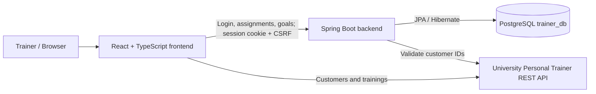
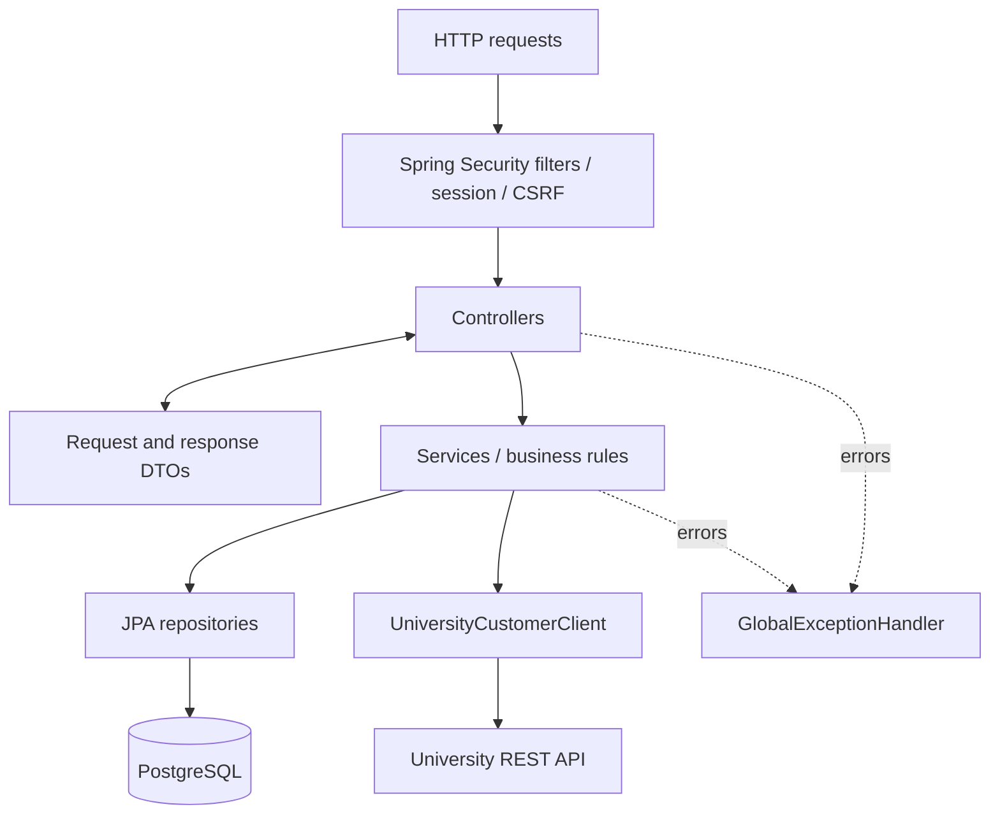
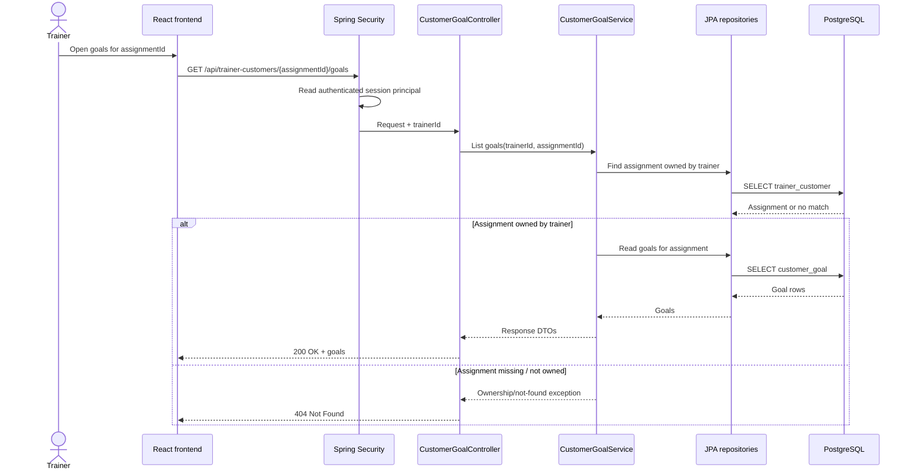
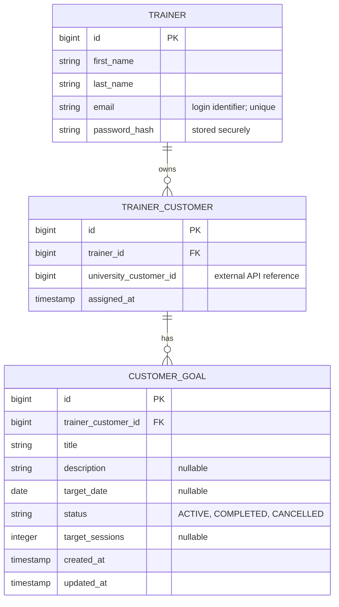
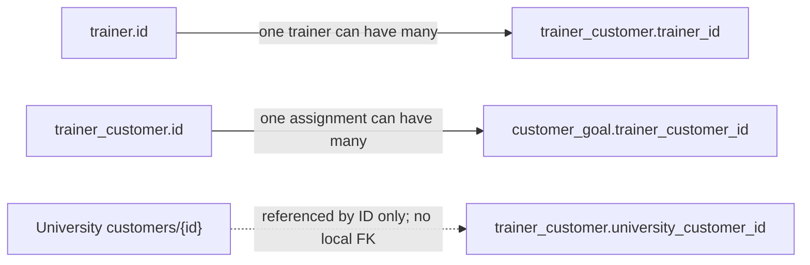
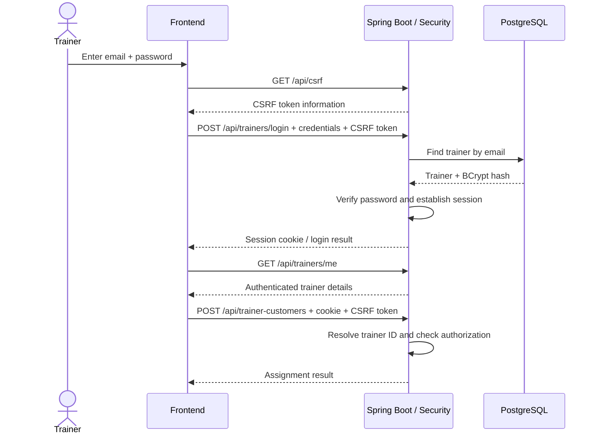

# Backend — Personal Trainer Management System

Spring Boot REST API for trainer accounts, session authentication, private customer assignments, and fitness goals. The backend validates requests, enforces trainer ownership, verifies university customer IDs, and persists trainer-specific data in PostgreSQL using Flyway migrations.

The completed application is deployed with a [Render backend](https://personal-trainer-backend-6mai.onrender.com) and a [Vercel frontend](https://personal-trainer-five-delta.vercel.app). See the [root README](../README.md) for the full-stack project.

## Contents

- [Technology stack](#technology-stack) 
- [Architecture](#architecture)
- [Database and migrations](#database-and-migrations)
- [Security](#security)
- [REST API](#rest-api)
- [Local development](#local-development)
- [Testing and CI](#testing-and-ci)
- [Deployment](#deployment)
- [Troubleshooting and limitations](#troubleshooting-and-limitations)

## Technology stack

Versions and dependencies are defined in [pom.xml](pom.xml).

| Concern | Technology |
| --- | --- |
| Language | Java 21 |
| Application framework | Spring Boot 4.1.1, Spring Web MVC |
| Security | Spring Security, HTTP sessions, BCrypt, CSRF protection |
| Persistence | Spring Data JPA / Hibernate |
| Production database | PostgreSQL hosted on Render |
| Local database | PostgreSQL 17 through Docker Compose |
| Automated test database | H2 in memory, PostgreSQL compatibility mode; test-scoped dependency |
| Schema migrations | Flyway, including PostgreSQL database support |
| Validation | Jakarta Bean Validation |
| Build | Maven; included wrappers `mvnw` and `mvnw.cmd` |
| Testing | JUnit Jupiter, Spring Boot test support, MockMvc, Spring Security test support, Mockito |
| Automation | GitHub Actions for backend tests and frontend lint/build checks |

## Architecture

The frontend accesses two separate APIs. The university service manages shared customer contact details and training sessions. This backend stores trainer accounts, references to university customers, and private fitness goals. It checks customer existence when creating an assignment; it does not duplicate university customer or training records.



### Backend layers



Requests follow **controller → service → repository**. Controllers validate DTOs and obtain the authenticated trainer ID. Services implement business rules and ownership checks; repositories perform persistence and trainer-scoped lookups. Response DTOs keep persistence entities and password hashes out of API responses.

| Package under `src/main/java/com/fitnesstracker/backend/` | Components |
| --- | --- |
| `controller` | `TrainerController`, `CsrfController`, `TrainerCustomerController`, `CustomerGoalController` |
| `service` | `TrainerService`, `TrainerCustomerService`, `CustomerGoalService`, `UniversityCustomerClient` |
| `repository` | `TrainerRepository`, `TrainerCustomerRepository`, `CustomerGoalRepository` |
| `model` | `Trainer`, `TrainerCustomer`, `CustomerGoal` (including `GoalStatus`) |
| `dto` | Registration/login, assignment, goal, and status request/response records |
| `security` | `SecurityConfig`: session, CSRF, authorization, logout, password encoder |
| `exception` | Domain exceptions and `GlobalExceptionHandler` |

### Goal request lifecycle



`assignmentId` is the local `trainer_customer.id`, distinct from `universityCustomerId`. Individual goal operations query by **goal ID, assignment ID, and authenticated trainer ID together**.

## Database and migrations

The final application schema contains `trainer`, `trainer_customer`, and `customer_goal`. Flyway also maintains its schema history table. Customer and training resources remain in the university service.



The diagram uses logical type labels. SQL definitions, nullability, defaults, and constraints are in the [migration scripts](src/main/resources/db/migration).

| Table | Columns and constraints |
| --- | --- |
| `trainer` | Identity `BIGINT` primary key; required `first_name`, `last_name`, `email`, `password_hash` (`VARCHAR(255)`); unique email |
| `trainer_customer` | Identity primary key; required trainer FK, external customer ID, and `assigned_at`; `uq_trainer_customer` makes `(trainer_id, university_customer_id)` unique; index on `trainer_id` |
| `customer_goal` | Identity primary key; required assignment FK, title, status, creation/update timestamps; optional `TEXT` description, date, and integer session target; index on `trainer_customer_id` |

`fk_trainer_customer_trainer` references `trainer(id)` without a delete cascade. `fk_customer_goal_trainer_customer` references `trainer_customer(id)` with **`ON DELETE CASCADE`**. `chk_customer_goal_status` restricts status to `ACTIVE`, `COMPLETED`, or `CANCELLED`; `chk_customer_goal_target_sessions` requires a positive session target when present.



Different trainers may assign the same university customer, but each trainer can assign that customer only once. Goals belong to an assignment and inherit its trainer ownership. Removing an assignment deletes its local goals through the database FK cascade; it does not delete the university customer or their training sessions. The external customer ID has no local foreign key.

Assignment and goal creation timestamps use database defaults. `CustomerGoal` maintains `updated_at` through JPA lifecycle callbacks; the migration also supplies its initial SQL default. Timestamp columns use `TIMESTAMP WITH TIME ZONE` and map to Java `Instant`.

### Flyway history

| Version | Migration | Purpose |
| --- | --- | --- |
| V1 | `V1__create_client_table.sql` | Create the original local `client` table |
| V2 | `V2__create_trainer_table.sql` | Create trainer accounts with unique emails and password hashes |
| V3 | `V3__drop_client_table.sql` | Drop `client`; customer records remain university-managed |
| V4 | `V4__create_trainer_customer_table.sql` | Add assignments, trainer FK, pair uniqueness, timestamp, and lookup index |
| V5 | `V5__create_customer_goal_table.sql` | Add goals, assignment FK with delete cascade, status/session checks, timestamps, and lookup index |

Spring Boot runs pending Flyway migrations at startup. Preserve applied migrations and add a new version for schema changes. Automated tests use the same migration scripts and validate the resulting schema against the JPA mappings.

## Security

- **Authentication:** registration hashes passwords with BCrypt and returns trainer details; it does not log the trainer in. Login verifies the hash, creates a `ROLE_TRAINER` authentication with the numeric trainer ID as principal, and saves its security context in the HTTP session. An existing session ID is rotated on login.
- **Sessions:** subsequent requests use the `JSESSIONID` cookie. Logout invalidates the session, clears authentication, and returns `204`.
- **CSRF:** `GET /api/csrf` is public. Spring Security uses a JavaScript-readable `XSRF-TOKEN` cookie and the `X-XSRF-TOKEN` header. The endpoint returns `token`, `headerName`, and `parameterName`; the frontend fetches this JSON and sends the token under the returned header name before mutations. CSRF applies to registration and login as well as authenticated mutations.
- **Access rules:** registration, login, and CSRF retrieval are public; other application requests require authentication. Unauthenticated protected requests return `401`; missing/invalid CSRF tokens can return `403` before controller processing.
- **Ownership:** controllers obtain `@AuthenticationPrincipal Long trainerId`; clients do not supply an authorization trainer ID. Assignment lookups include the trainer ID. Goal lists verify the parent assignment, and individual goal lookups include the goal, assignment, and trainer IDs. Missing or foreign-owned resources return `404`.



Password hashes are never included in response DTOs. Unknown emails and incorrect passwords both produce `Invalid email or password`.

## REST API

Local base URL: `http://localhost:8080`. Deployed base URL: `https://personal-trainer-backend-6mai.onrender.com`. JSON bodies use `Content-Type: application/json`; mutations require a CSRF token, and protected operations require a session cookie.

### Accounts and authentication

| Method | Path | Success response |
| --- | --- | --- |
| `GET` | `/api/csrf` | `200`: CSRF token information |
| `POST` | `/api/trainers/register` | `201`: trainer profile; sign in separately |
| `POST` | `/api/trainers/login` | `200`: trainer profile and authenticated session |
| `POST` | `/api/trainers/logout` | `204`: session invalidated; handled by Spring Security |
| `GET` | `/api/trainers/me` | `200`: authenticated trainer profile |

Registration request:

```json
{
  "firstName": "Alex",
  "lastName": "Smith",
  "email": "alex@example.com",
  "password": "SecurePassword123!"
}
```

Login accepts `email` and `password`. Registration, login, and current-trainer responses share this shape (IDs are illustrative):

```json
{
  "id": 1,
  "firstName": "Alex",
  "lastName": "Smith",
  "email": "alex@example.com"
}
```

### Customer assignments

| Method | Path | Success response |
| --- | --- | --- |
| `GET` | `/api/trainer-customers` | `200`: current trainer's assignments |
| `POST` | `/api/trainer-customers` | `201`: new assignment after university customer verification |
| `GET` | `/api/trainer-customers/{assignmentId}` | `200`: owned assignment |
| `DELETE` | `/api/trainer-customers/{assignmentId}` | `204`: assignment and its goals removed |

Assignment request:

```json
{"universityCustomerId": 3}
```

Example response:

```json
{
  "id": 7,
  "universityCustomerId": 3,
  "assignedAt": "2026-11-18T10:00:00Z"
}
```

`UniversityCustomerClient` uses Spring `RestClient` to call `GET /customers/{id}` at the hard-coded base URL `https://customer-rest-service-frontend-personaltrainer.2.rahtiapp.fi/api`. A missing customer produces `404`; upstream request failures produce `503`. Duplicate assignments are rejected before the external call and also protected by database uniqueness.

### Fitness goals

All paths below begin with `/api/trainer-customers/{assignmentId}/goals`.

| Method | Path suffix | Success response |
| --- | --- | --- |
| `GET` | (none) | `200`: goals for the owned assignment |
| `POST` | (none) | `201`: new goal with status `ACTIVE` |
| `GET` | `/{goalId}` | `200`: owned goal |
| `PUT` | `/{goalId}` | `200`: updated editable details; status and ownership unchanged |
| `PATCH` | `/{goalId}/status` | `200`: updated status |
| `DELETE` | `/{goalId}` | `204`: goal deleted |

Create/update request (`PUT` replaces these editable details; omitted optional values become null):

```json
{
  "title": "Complete 12 strength sessions",
  "description": "Build consistency with strength training",
  "targetDate": "2027-02-28",
  "targetSessions": 12
}
```

Status request:

```json
{"status": "COMPLETED"}
```

Example goal response:

```json
{
  "id": 9,
  "assignmentId": 7,
  "title": "Complete 12 strength sessions",
  "description": "Build consistency with strength training",
  "targetDate": "2027-02-28",
  "targetSessions": 12,
  "status": "ACTIVE",
  "createdAt": "2026-11-18T10:05:00Z",
  "updatedAt": "2026-11-18T10:05:00Z"
}
```

### Validation and errors

Registration requires nonblank names, a valid nonblank email, and a password of at least eight characters. Assignment customer IDs must be present and positive. Goals require a nonblank title of at most 255 characters; optional descriptions are limited to 2,000 characters, and optional session targets must be positive integers. Dates use `YYYY-MM-DD`; past target dates are allowed. Status must be `ACTIVE`, `COMPLETED`, or `CANCELLED`.

| Status | Meaning |
| --- | --- |
| `400` | Invalid request, JSON value, or Bean Validation failure |
| `401` | Unauthenticated protected request or invalid login credentials |
| `403` | Security rejection, including missing/invalid CSRF token |
| `404` | Missing university customer, assignment, or goal; foreign-owned assignment/goal |
| `409` | Duplicate trainer email or customer assignment |
| `503` | University customer verification unavailable |

`GlobalExceptionHandler` returns domain errors as `{"error":"message"}`. Bean Validation failures include field errors, for example:

```json
{
  "error": "Validation failed",
  "fields": {"title": "Goal title is required"}
}
```

Security-filter and malformed-request errors can use framework response formats rather than this domain-error shape.

## Local development

Choose one backend startup option. Docker Compose is defined in the [root compose.yaml](../compose.yaml). Both options use database `trainer_db`, user `trainer`, and local PostgreSQL port `5433`.

### Option A: backend and PostgreSQL in Docker

Requires Docker Engine/Desktop with Compose. From the repository root, create an untracked `.env` file:

```dotenv
POSTGRES_PASSWORD=your-local-database-password
```

Then run:

```bash
docker compose up -d --build
docker compose ps
```

Compose starts `postgres` (`trainer-postgres`) and `backend` (`trainer-backend`), exposing `127.0.0.1:5433` and `http://localhost:8080`. The backend waits for the database health check and connects internally to `postgres:5432`. Compose supplies `SPRING_DATASOURCE_URL`, `SPRING_DATASOURCE_USERNAME`, and `SPRING_DATASOURCE_PASSWORD`; no exported `DB_PASSWORD` is needed for this option.

### Option B: PostgreSQL in Docker, Spring Boot on the host

Requires Java 21 and Docker Compose. Set the same root `.env` as above, then run from the repository root:

```bash
docker compose stop backend
docker compose up -d postgres
cd backend
export DB_PASSWORD="your-local-database-password"
./mvnw spring-boot:run
```

Stopping the Compose backend frees port `8080` for the host process. [application.properties](src/main/resources/application.properties) uses `jdbc:postgresql://localhost:5433/trainer_db`, username `trainer`, and `${DB_PASSWORD}`. The exported password must match `POSTGRES_PASSWORD`; the Maven launch does not automatically load the root Compose `.env`.

Flyway applies pending migrations when either backend starts. The database persists in the `trainer_postgres_data` Docker volume. Changing the initialization password in `.env` does not change credentials in an existing volume.

### Frontend connection and useful commands

The checked-in [Vite proxy](../frontend/vite.config.ts) targets Render. To connect the frontend to your local backend, set its `/api` proxy target to `http://localhost:8080` and restart Vite. Follow the [root setup instructions](../README.md#local-development) for the university API configuration and frontend startup.

From the repository root:

```bash
docker compose logs backend
docker compose logs postgres
docker compose down
```

`docker compose down` retains the named database volume. Adding `-v` removes that data.

## Testing and CI

Run from `backend/`; Java 21 and the Maven wrapper are sufficient, with no running PostgreSQL server or `DB_PASSWORD` required:

```bash
./mvnw test
```

[test application.properties](src/test/resources/application.properties) selects `jdbc:h2:mem:fitness-test;MODE=PostgreSQL;DB_CLOSE_DELAY=-1`. Flyway runs V1–V5 against H2, and `spring.jpa.hibernate.ddl-auto=validate` checks the JPA schema mappings. H2 is a test-scoped dependency. PostgreSQL compatibility mode **does not guarantee complete PostgreSQL compatibility**; these tests do not establish production database parity.

The suite covers context startup, repository persistence, password hashing, registration/login/logout, session access, CSRF, customer assignments, goal operations, validation, and trainer ownership. Assignment controller tests mock `UniversityCustomerClient`, so they do not require live university customer verification.

### GitHub Actions and CodeQL

The [CI workflow](../.github/workflows/ci.yml) runs on pushes and pull requests to `main`:

- **Backend:** Ubuntu, Temurin Java 21, Maven dependency caching, and `./mvnw --batch-mode test` from `backend/`.
- **Frontend:** Node.js 22, `npm ci`, `npm run lint`, and `npm run build` from `frontend/`.
- **Database provisioning:** the backend job starts PostgreSQL 17 on port `5433` and sets `DB_PASSWORD`, but the current test configuration selects H2. The provisioned PostgreSQL service is not the test database.

No CodeQL workflow or CodeQL action is checked into this repository. GitHub-managed CodeQL default setup, if enabled in repository settings, cannot be confirmed from these files. The checked-in CI workflow builds and tests; it does not deploy the application or run CodeQL analysis.

## Deployment

| Component | Hosting | URL |
| --- | --- | --- |
| Backend | Render | [personal-trainer-backend-6mai.onrender.com](https://personal-trainer-backend-6mai.onrender.com) |
| Frontend | Vercel | [personal-trainer-five-delta.vercel.app](https://personal-trainer-five-delta.vercel.app) |
| Production database | Render PostgreSQL | Connection details supplied privately through environment variables |

The [backend Dockerfile](Dockerfile) builds with Maven and Java 21, then runs the executable JAR on a Java 21 JRE. Tests are skipped during Docker image packaging and run separately in CI.

Production PostgreSQL connection settings are supplied using `SPRING_DATASOURCE_URL` (JDBC URL), `SPRING_DATASOURCE_USERNAME`, and `SPRING_DATASOURCE_PASSWORD`, overriding the local defaults. Credentials belong in the hosting environment rather than source control. Render service settings and database credentials are managed outside this repository.

[vercel.json](../frontend/vercel.json) forwards `/api/*` to the Render backend and `/university-api/*` to the university service, with an SPA fallback. The frontend therefore uses same-origin API paths through Vercel; its university API base is configured at build time as `VITE_TRAINER_API=/university-api/`. Browser sessions and CSRF protection apply to deployed requests as well.

## Troubleshooting and limitations

| Symptom | What to check |
| --- | --- |
| PostgreSQL connection refused | `docker compose ps`, port `5433`, database health, and selected startup option |
| Password authentication fails | Host `DB_PASSWORD` matches the database password; an existing Docker volume retains its original credentials |
| Port `8080` already in use | Stop the Compose backend before running Spring Boot on the host |
| Flyway validation/startup failure | Migration history and startup logs; avoid changing already-applied migrations |
| Protected endpoint returns `401` | Login succeeded and the client retains/sends the session cookie |
| Mutation returns `403` | Fetch `/api/csrf`, preserve cookies, and send the token using the returned `headerName` |
| Assignment/goal returns `404` | Use the local assignment ID and the owning trainer's session |
| Assignment creation returns `503` | University customer verification may be unavailable |
| Frontend uses deployed data during local development | The checked-in Vite `/api` proxy targets Render; point it at the local backend |
| Customer/training requests fail while backend works | Check the separate university service and frontend university API configuration |

Goal session targets are stored values; university training records do not automatically update goal progress or status. University customer and training edits affect shared external data. Assignment creation depends on the university API being available, and the external API base URL is currently hard-coded in `UniversityCustomerClient`.
