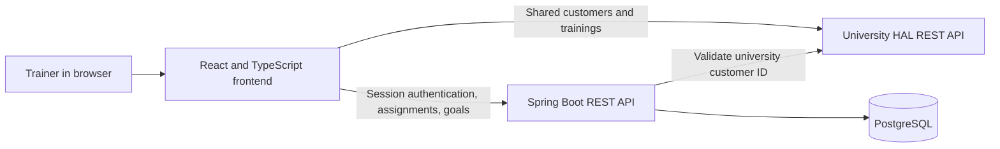
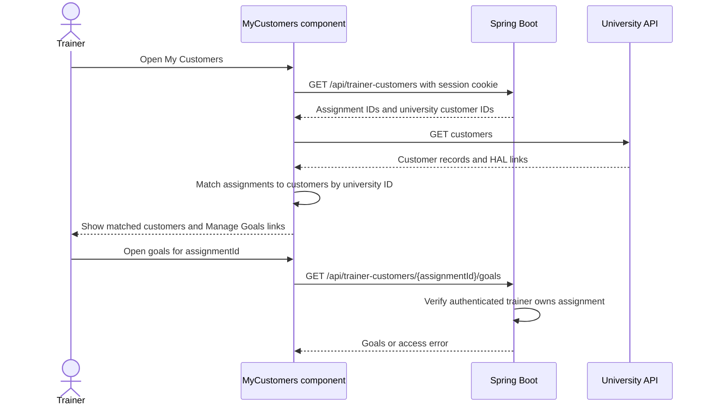
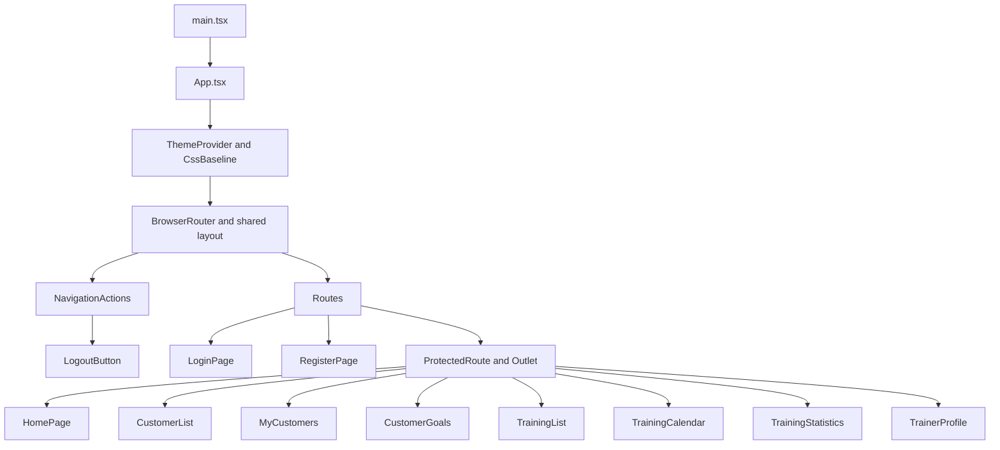
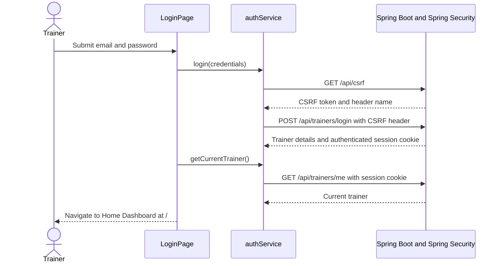

# Personal Trainer Management System — Frontend

React and TypeScript frontend for managing trainer accounts, customer assignments, fitness goals, and training sessions. A Spring Boot backend provides session authentication and trainer-owned assignments and goals; the university REST API supplies the shared customer directory and training records.

**Live application:** [Personal Trainer Management System](https://personal-trainer-five-delta.vercel.app)

**Backend:** [Spring Boot on Render](https://personal-trainer-backend-6mai.onrender.com)

See the [project README](../README.md) for the full-stack overview and the [backend README](../backend/README.md) for backend setup and API documentation.

## Contents

- [Features](#features)
- [Technology stack](#technology-stack)
- [Architecture and data sources](#architecture-and-data-sources)
- [Application routes](#application-routes)
- [Project structure](#project-structure)
- [Local development](#local-development)
- [Authentication and security](#authentication-and-security)
- [Design system](#design-system)
- [Testing and quality](#testing-and-quality)
- [Deployment](#deployment)
- [Known limitations](#known-limitations)

## Features

### Trainer accounts

- Register with first name, last name, email, and password; successful registration returns to login without signing in automatically.
- Sign in, sign out, and access protected application routes.
- View and refresh a read-only trainer profile with name, email, and account type.

### Home Dashboard

- Personalized trainer greeting and a dashboard refresh action.
- Assigned customer count and active goal count for the authenticated trainer. The customer count includes assignments that still match a university directory record.
- Training session count and total training minutes from **all records returned by the university API**, independent of the trainer's assignments. Only positive, finite durations contribute to the minute total.
- Up to five active goal deadlines, ordered nearest first and including today. Undated and overdue goals remain in the active count but are excluded from the upcoming list.
- A warning if some goal requests fail and the displayed goal totals may be incomplete.

### Customer management

- Browse university customer contact details; search by field through Data Grid column filters, sort columns, filter records, and paginate with 10, 25, or 50 rows per page.
- Add, edit, and delete university customers, with form validation and deletion confirmation.
- Assign university customers to the logged-in trainer or remove their assignments from the directory.
- View matched assigned customers on **My Customers** and open their fitness goals.
- Export customer contact data as `CustomerList.csv`. Export includes all loaded directory records, rather than just the visible page or filtered rows.

Customer changes affect the **shared university directory**. Removing a trainer assignment is a separate Spring Boot operation and does not delete the university customer.

### Fitness goals

- Create, view, edit, and delete goals for a customer assignment.
- Supply a required title and optional description, target date, and positive integer session target.
- Change status between `ACTIVE`, `COMPLETED`, and `CANCELLED`.
- Receive loading, validation, success, and error feedback; deletion requires confirmation.
- Spring Boot enforces assignment and goal ownership using the authenticated trainer.

### Training management

- Browse university training sessions with date/time, activity, duration, and associated customer information.
- Create sessions for university customers using a date/time picker.
- Delete sessions after confirmation. Existing sessions cannot be edited.

### Training calendar and statistics

- Read-only **MUI X Scheduler** calendar with Month, Week, and Day views and selectable event details, including activity, customer, and duration. Event end times use the session duration.
- **MUI X Charts** horizontal bar chart showing total training minutes grouped by activity. Names are trimmed and grouped without case sensitivity; missing activities and invalid or nonpositive durations are excluded. Activities are ordered by total minutes.
- Both pages use **shared university training data**, rather than only sessions for the trainer's assigned customers.

### Interface

Responsive Material UI layouts, desktop links and mobile navigation menu, Data Grid tables, dialogs, loading indicators, empty states, validation feedback, and API error handling support the application pages.

## Technology stack

The following are the declared version ranges in [package.json](package.json); [package-lock.json](package-lock.json) records resolved versions.

| Technology / package | Declared version | Purpose |
| --- | --- | --- |
| React / React DOM (`react`, `react-dom`) | `^19.3.1` | UI rendering |
| TypeScript (`typescript`) | `~6.0.2` | Static typing |
| Vite (`vite`) | `^8.1.1` | Development server and production build |
| React Router (`react-router-dom`) | `^7.18.4` | Client routes and navigation |
| Material UI (`@mui/material`, `@mui/icons-material`) | `^9.5.0` | Components, theme, icons |
| Emotion (`@emotion/react` / `@emotion/styled`) | `^11.14.0` / `^11.14.1` | MUI styling |
| MUI X Data Grid (`@mui/x-data-grid`) | `^9.15.0` | Tables, sorting, filtering, pagination |
| MUI X Scheduler (`@mui/x-scheduler`) | `^9.0.0-beta.15` | Training calendar |
| MUI X Charts (`@mui/x-charts`) | `^9.17.0` | Training statistics |
| MUI X Date Pickers (`@mui/x-date-pickers`) | `^9.17.0` | Training date/time selection |
| Axios (`axios`) | `^1.20.0` | API requests |
| Day.js (`dayjs`) | `^1.11.23` | Date handling and formatting |
| ESLint (`eslint`) | `^10.6.0` | Lint checks |

## Architecture and data sources



### Two API connections

| API | Frontend configuration | Data responsibility |
| --- | --- | --- |
| University REST API | `VITE_TRAINER_API` in `trainerService.ts` | Shared customers and training sessions |
| Spring Boot REST API | Relative `/api` base URL with credentials | Accounts, authentication, trainer assignments, fitness goals |

The university base URL for direct local access is `https://customer-rest-service-frontend-personaltrainer.2.rahtiapp.fi/api/`. Collection responses use HAL `_embedded.customers` and `_embedded.trainings`, with `_links` identifying individual and related resources.

Customer IDs are parsed from numeric `/customers/{id}` HAL self-links, since customer objects do not expose a normal top-level ID. Training customer links may instead use `/trainings/{id}/customer`. `fetchCustomersByURL` validates HTTP(S) links and these supported resource paths, then requests the path through the configured university Axios client. This keeps production relationship requests behind the Vercel proxy instead of following absolute HAL URLs directly.

Spring Boot stores trainer accounts, assignments, and goals in PostgreSQL. Customer contact details and training sessions stay in the university service; the browser never connects directly to the database.

### Assignment identifiers and request flow

- `universityCustomerId` identifies a customer in the university service.
- `assignmentId` identifies the trainer-customer relationship in PostgreSQL. Assignment responses expose this as `id`; goal responses include `assignmentId`.
- `/my-customers/:assignmentId/goals` uses the **assignment ID**. Spring Boot derives the trainer identity from the session and checks ownership.



## Application routes

Routes are defined in [src/App.tsx](src/App.tsx).

| Path | Component | Access | Page |
| --- | --- | --- | --- |
| `/` | `HomePage` | Protected | Home Dashboard |
| `/login` | `LoginPage` | Public | Login |
| `/register` | `RegisterPage` | Public | Registration |
| `/customers` | `CustomerList` | Protected | Customer Directory |
| `/my-customers` | `MyCustomers` | Protected | Assigned Customers |
| `/my-customers/:assignmentId/goals` | `CustomerGoals` | Protected | Fitness Goals |
| `/trainings` | `TrainingList` | Protected | Training List |
| `/calendar` | `TrainingCalendar` | Protected | Training Calendar |
| `/statistics` | `TrainingStatistics` | Protected | Training Statistics |
| `/profile` | `TrainerProfile` | Protected | Trainer Profile |

`MyCustomers` is exported from `src/pages/MyCustomer.tsx` (singular filename).



## Project structure

Focused view of the frontend source and configuration:

```text
frontend/
├── README.md
├── package.json
├── package-lock.json
├── index.html                    # Application title and React mount point
├── vite.config.ts                # Development /api proxy
├── vercel.json                   # Production proxies and SPA fallback
├── eslint.config.js
├── tsconfig.json
├── tsconfig.app.json
├── tsconfig.node.json
└── src/
    ├── main.tsx
    ├── App.tsx                   # Theme, shared layout, routes
    ├── App.css
    ├── index.css                 # Base styles and calendar detail override
    ├── components/
    │   ├── NavigationActions.tsx
    │   ├── LogoutButton.tsx
    │   └── ProtectedRoute.tsx
    ├── pages/
    │   ├── HomePage.tsx
    │   ├── LoginPage.tsx
    │   ├── RegisterPage.tsx
    │   ├── TrainerProfile.tsx
    │   ├── CustomerList.tsx
    │   ├── MyCustomer.tsx         # Exports MyCustomers
    │   ├── CustomerGoals.tsx
    │   ├── TrainingList.tsx
    │   ├── TrainingCalendar.tsx
    │   └── TrainingStatistics.tsx
    ├── services/
    │   ├── authService.ts
    │   ├── trainerService.ts      # University customer/training operations
    │   ├── trainerCustomerService.ts
    │   └── customerGoalService.ts
    └── types/
        ├── trainer.ts            # University customer/training types
        └── spring_trainer.ts     # Trainer and authentication types
```

Pages handle presentation and interactions, services provide API operations, and types describe API data. Dashboard and profile also make direct Axios requests to Spring Boot.

## Local development

### Prerequisites

Use **Node.js 22.12 or later in the Node 22 series** and npm to align with CI's Node 22 configuration. The locked Vite package declares `^20.19.0 || >=22.12.0`; older Node versions are unsuitable. Network access to the university API and a reachable Spring Boot backend are required.

### Configure API access

From the repository root, create `frontend/.env.local`:

```dotenv
VITE_TRAINER_API=https://customer-rest-service-frontend-personaltrainer.2.rahtiapp.fi/api/
```

Keep the trailing slash for relative university resource paths. This variable configures the **university API**, not Spring Boot. The client throws an error if it is missing. Vite exposes `VITE_` values to the browser, so use them only for public configuration.

The checked-in [vite.config.ts](vite.config.ts) forwards `/api` to `https://personal-trainer-backend-6mai.onrender.com`. You can use that deployed backend without starting a local backend or database.

To use local Spring Boot instead, change the existing `/api` proxy target to:

```ts
"/api": {
  target: 'http://localhost:8080',
  changeOrigin: true,
  secure: true,
}
```

Start PostgreSQL and Spring Boot using **one** of the workflows in the [backend local development guide](../backend/README.md#local-development). Docker Compose can start both services; the Maven alternative starts only the database through Compose and runs Spring Boot separately. Do not start a second backend on port 8080.

Only `/api` is proxied by the Vite development configuration. Use the absolute university URL above locally; `/university-api/` is configured by Vercel for production.

### Install and run

From the repository root, in a separate terminal:

```bash
cd frontend
npm ci
npm run dev
```

`npm ci` installs the lockfile's recorded dependency versions. Open the URL printed by Vite, normally `http://localhost:5173`. Restart Vite after environment or proxy changes.

| Command | Purpose |
| --- | --- |
| `npm ci` | Install locked dependencies |
| `npm run dev` | Start Vite with hot reload and the development proxy |
| `npm run lint` | Run ESLint |
| `npm run build` | Run `tsc -b`, then build static assets with Vite |
| `npm run preview` | Preview the generated build locally |

`npm run preview` is a static build preview, not the Vercel runtime; it does not apply `vercel.json` rewrites. Use the development server or deployed application for API integration checks.

## Authentication and security

Spring Security manages server-side sessions, using a browser session cookie (`JSESSIONID`). Spring Boot Axios requests include `withCredentials: true`; the frontend does not use a local-storage bearer token.



Authentication operations obtain a CSRF token from `/api/csrf` and send it with the response-specified header name. Assignment and goal mutations also fetch a token and send `X-XSRF-TOKEN`. Registration is public but still requires CSRF protection. Logout obtains a token, posts to `/api/trainers/logout`, and returns to `/login` after success.

`ProtectedRoute` checks `/api/trainers/me`, shows a loading indicator while checking, renders an `Outlet` after success, and redirects to `/login` on failure. This controls client navigation. **Actual API authorization and trainer ownership are enforced by Spring Boot**, which also validates inputs and hashes passwords with BCrypt. University API operations use their separate client and are subject to that external service's controls.

## Design system

[src/App.tsx](src/App.tsx) defines a light Material UI theme with rounded components and Roboto/Arial typography:

| Theme token | Color |
| --- | --- |
| Primary / lime | `#9BE564` |
| Secondary / forest | `#174D43` |
| Page background | `#F7FAF5` |
| Paper | `#FFFFFF` |
| Main text | `#253B35` |
| Secondary text | `#718079` |
| Success / error | `#39845E` / `#D94F55` |

Desktop navigation uses horizontal links; below the MUI `md` breakpoint it becomes a menu with logout still accessible. Navigation is hidden on login and registration pages. Authentication layouts adapt from image/form panels to a compact form on small screens. Tables use horizontal scrolling where needed; forms, cards, charts, and dialogs use responsive spacing.

[src/index.css](src/index.css) supplies resets, a 320px minimum body width, responsive images, and a calendar detail override hiding the unused resource row. Its base body color is `#f8fafc`; the MUI theme and application wrapper supply the visible themed page background.

## Testing and quality

Run from `frontend/`:

```bash
npm run lint
npm run build
```

There is no frontend unit-test script or automated frontend unit-test suite in the repository. Build and lint checks do not replace browser integration testing.

[GitHub Actions](../.github/workflows/ci.yml) runs on pushes and pull requests to `main`. The frontend job uses Node 22, runs `npm ci`, `npm run lint`, and `npm run build`. A separate backend job runs Maven tests with Java 21 and provisions PostgreSQL 17.

### Manual smoke-test checklist

Use disposable university records for create/update/delete checks, since that data is shared.

- [ ] Registration validates input and returns to login; invalid login shows an error.
- [ ] Successful login opens `/`; logout returns to `/login` and protected pages require a session.
- [ ] Home greeting, assigned customer count, active goals, shared training totals, refresh, and up to five upcoming deadlines display correctly.
- [ ] Customer Directory loads; field filtering/search, sorting, pagination, and CSV export work.
- [ ] Customer creation, editing, deletion confirmation, assignment, and assignment removal work.
- [ ] My Customers shows only matching assignments for the current trainer; Manage Goals uses the assignment ID.
- [ ] Goals support creation, editing, optional fields, all three statuses, and deletion confirmation; invalid or another trainer's assignment URL does not expose goals.
- [ ] Training List resolves customer information, creates sessions with date/time selection, and deletes only after confirmation.
- [ ] Calendar supports Month, Week, and Day views and event details without allowing calendar edits.
- [ ] Statistics aggregate university minutes by activity and show appropriate empty/error states.
- [ ] Profile displays the logged-in trainer's read-only information and refreshes.
- [ ] Desktop/mobile navigation, horizontally scrollable tables, dialogs, loading states, validation, and API errors remain usable at narrow widths.
- [ ] Direct visits and refreshes on deployed nested routes work; the browser console shows no unexpected errors.

## Deployment

The completed frontend is deployed on [Vercel](https://personal-trainer-five-delta.vercel.app), with the [Spring Boot backend on Render](https://personal-trainer-backend-6mai.onrender.com).

For Vercel, use `frontend` as the project root, `npm run build` as the build command, and `dist` as the output directory. Set the public university API base URL **at build time**:

```dotenv
VITE_TRAINER_API=/university-api/
```

Rebuild after changing Vite environment values. [vercel.json](vercel.json) applies these rewrites in order:

| Incoming path | Destination |
| --- | --- |
| `/university-api/:path*` | `https://customer-rest-service-frontend-personaltrainer.2.rahtiapp.fi/api/:path*` |
| `/api/:path*` | `https://personal-trainer-backend-6mai.onrender.com/api/:path*` |
| `/(.*)` | `/index.html` |

The API rewrites let browser requests use the frontend origin while Vercel forwards them to the appropriate service. The final SPA fallback serves React for direct visits or refreshes on routes such as `/calendar` and `/my-customers/1/goals`. Vite's development proxy is separate from these production rewrites.

## Known limitations

- Existing training sessions cannot be edited; the calendar is read-only.
- Goal session targets do not automatically calculate progress from training records or update goal status.
- Training lists, calendar, statistics, and dashboard training totals use shared university data and are not scoped to the logged-in trainer's assignments.
- Customer and training features depend on external university API availability. My Customers omits assignments without a matching directory record.

For database, migration, session, and backend troubleshooting, see the [backend README](../backend/README.md).
