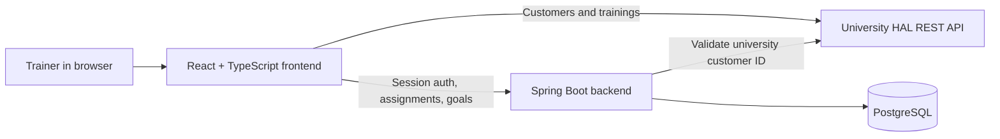
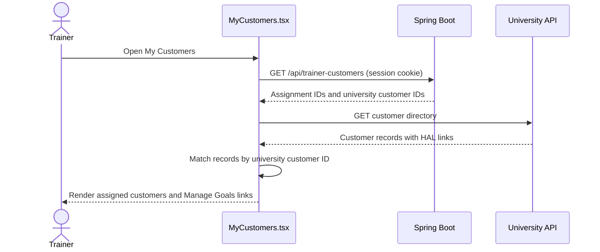
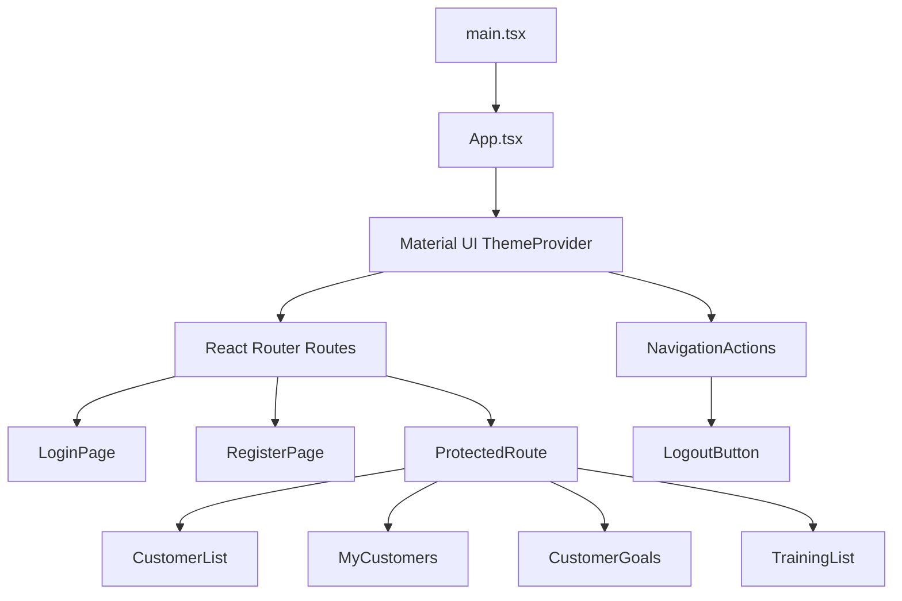
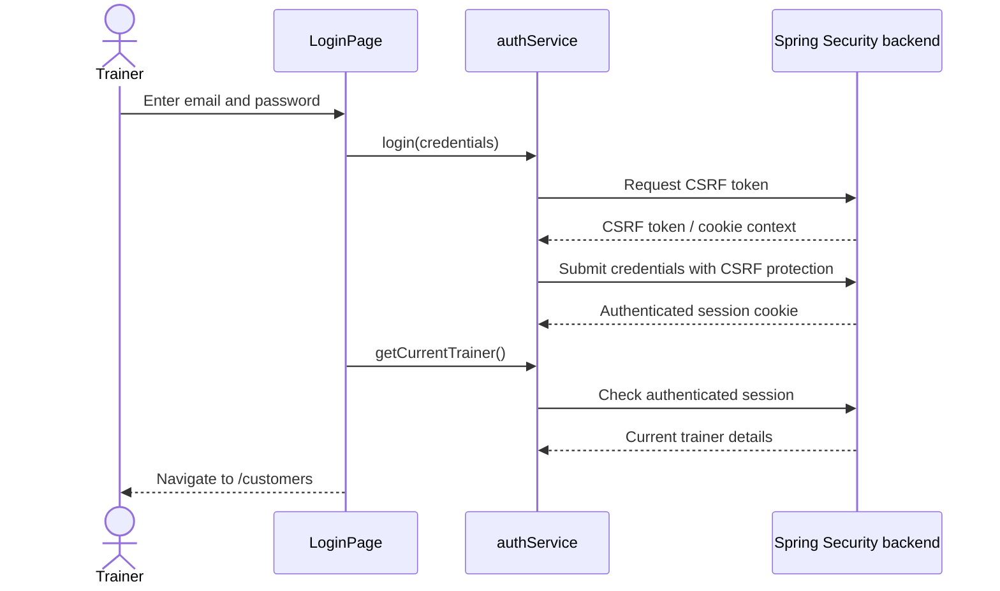

# Frontend — Personal Trainer Management System

React + TypeScript interface for the **Personal Trainer Management System**. This frontend combines the university's customer/training REST API with trainer-specific assignments and fitness goals stored by our Spring Boot backend.

> **Repository location:** Save this document as `frontend/README.md`. The root `README.md` describes the whole application; `backend/README.md` documents the Java service, security, and database.

## Contents

1. [What the frontend does](#what-the-frontend-does)
2. [Technology stack](#technology-stack)
3. [Architecture and data sources](#architecture-and-data-sources)
4. [Application routes](#application-routes)
5. [Project structure](#project-structure)
6. [Installation and local development](#installation-and-local-development)
7. [Authentication and security](#authentication-and-security)
8. [Customer assignments and fitness goals](#customer-assignments-and-fitness-goals)
9. [Design system and responsive UI](#design-system-and-responsive-ui)
10. [Testing and quality checks](#testing-and-quality-checks)
11. [Production build and deployment notes](#production-build-and-deployment-notes)
12. [Troubleshooting](#troubleshooting)
13. [Planned work](#planned-work)

## What the frontend does

The application is designed for personal trainers to:

- **Register and sign in** using the Spring Boot backend.
- **Browse the university customer directory** and see customer contact information.
- **Assign or remove customers** from their own trainer account.
- **View My Customers**, a trainer-specific list of assigned customers.
- **Create and manage fitness goals** for an assigned customer, including a title, description, target date, target session count, and status (`ACTIVE`, `COMPLETED`, or `CANCELLED`).
- **Browse training sessions** from the university API, including activity, duration, date/time, and associated customer.

Assignments and fitness goals are **private to the logged-in trainer**. The frontend displays only the relevant information, while the backend independently enforces ownership.

### Current feature status

| Area | Implemented |
| --- | --- |
| Trainer registration / login / logout | Yes |
| Protected client-side routes | Yes |
| University customer directory | Yes |
| Assign / remove a customer | Yes |
| List assigned customers | Yes |
| Create, edit, delete, and change goal status | Yes |
| University training list | Yes |
| Responsive green Material UI theme | Yes |
| Export customers to CSV | Planned |
| Training calendar (month/week/day) | Planned |
| Training statistics charts | Postponed |
| Production cloud deployment | Planned / verify deployment status |

This table describes the current project scope discussed during development. Update it when features are implemented.

## Technology stack

- **React 19** — component-based UI.
- **TypeScript** — types for components, API data, and form values.
- **Vite 8** — development server and production bundling.
- **React Router 7** — routes, navigation, and protected page layout.
- **Material UI (MUI)** — layout, form components, buttons, dialogs, alerts, and theme.
- **MUI X Data Grid** — paginated customer and training tables.
- **Axios** — HTTP requests.
- **Day.js** — formatting training dates and times.
- **ESLint** — code quality checks.

Exact installed dependency versions are maintained in [`package.json`](./package.json) and [`package-lock.json`](./package-lock.json).

## Architecture and data sources

**This frontend talks to two different services.** They have different purposes and should not be confused.



### University REST API

Public customer and training records are retrieved from the university service:

`https://customer-rest-service-frontend-personaltrainer.2.rahtiapp.fi/api`

Typical resources include `customers` and `trainings`. The responses use **HAL links**, including `_links.self.href` and links to related resources. The frontend extracts customer IDs from HAL self-links because a customer may not have a normal top-level `id` field.

### Our Spring Boot REST API

Our backend manages:

- Trainer registration and authenticated sessions.
- Customer assignments belonging to the currently authenticated trainer.
- Fitness goals belonging to a trainer-customer assignment.
- Server-side validation and authorization.

The backend uses PostgreSQL. The browser does **not** connect to PostgreSQL directly.

### Request flow: viewing assigned customers



**Two different identifiers are used:**

- `universityCustomerId` identifies the person in the university API.
- `assignmentId` identifies the association between a trainer and that person in our PostgreSQL database.

The Fitness Goals route uses **`assignmentId`**, not `universityCustomerId`.

## Application routes

| URL | Component | Access | Purpose |
| --- | --- | --- | --- |
| `/login` | `LoginPage` | Public | Sign in |
| `/register` | `RegisterPage` | Public | Create trainer account |
| `/` | `CustomerList` | Protected | Default customer directory |
| `/customers` | `CustomerList` | Protected | Browse and assign university customers |
| `/my-customers` | `MyCustomers` | Protected | See this trainer's assignments |
| `/my-customers/:assignmentId/goals` | `CustomerGoals` | Protected | Manage goals for one assignment |
| `/trainings` | `TrainingList` | Protected | Browse university training sessions |

`ProtectedRoute` handles frontend navigation decisions. **It is not a security boundary by itself**: Spring Security protects backend endpoints regardless of what the React UI displays.

### Component map



## Project structure

The main files are organized as follows (this is a **focused view**, not a complete directory listing):

```text
frontend/
├── README.md
├── package.json
├── package-lock.json
├── index.html
├── vite.config.ts
├── tsconfig.json                 # TypeScript configuration files may vary
├── src/
│   ├── main.tsx                  # React entry point
│   ├── App.tsx                   # Global theme, navigation layout, routes
│   ├── index.css                 # Global resets and base styles
│   ├── components/
│   │   ├── NavigationActions.tsx # Responsive navbar and active route state
│   │   ├── LogoutButton.tsx      # Logout action
│   │   └── ProtectedRoute.tsx    # Authentication gate for private pages
│   ├── pages/
│   │   ├── LoginPage.tsx
│   │   ├── RegisterPage.tsx
│   │   ├── CustomerList.tsx
│   │   ├── MyCustomers.tsx
│   │   ├── CustomerGoals.tsx
│   │   └── TrainingList.tsx
│   ├── services/
│   │   ├── authService.ts
│   │   ├── trainerService.ts
│   │   ├── trainerCustomerService.ts
│   │   └── customerGoalService.ts
│   └── types/
│       └── trainer.ts            # University customer/training types
└── dist/                         # Generated by npm run build; do not commit
```

The **pages** contain the visible UI and event handling. **Services** isolate API calls. **Types** describe data formats. This separation helps keep individual pages focused on presentation and user interactions.

## Installation and local development

### Prerequisites

1. **Node.js and npm** compatible with your installed Vite version. Check `package.json` and the Vite version's Node.js engine requirement rather than assuming an older Node release will work.
2. The **Spring Boot backend** running locally for registration, authentication, assignments, and goals.
3. Internet/network access to the **university REST API** for customer and training data.
4. PostgreSQL running for the backend (normally through the root `compose.yaml`).

### Start the database and backend

From the repository root, use your existing Docker Compose and Maven setup:

```bash
# Run from the repository root

docker compose up -d

cd backend
./mvnw spring-boot:run
```

The backend must have its required environment variables configured (notably `DB_PASSWORD`). Refer to [`../backend/README.md`](../backend/README.md) for verified database connection details, migrations, and backend troubleshooting.

### Install frontend dependencies

Open a separate terminal:

```bash
cd frontend
npm ci
```

Use `npm ci` when a lockfile exists so your dependencies match the repository's recorded versions.

### Configure API access

The university API client uses the Vite environment variable **`VITE_TRAINER_API`**. A typical local configuration in `frontend/.env.local` is:

```dotenv
VITE_TRAINER_API=https://customer-rest-service-frontend-personaltrainer.2.rahtiapp.fi/api/
```

The trailing slash is useful because the university API client requests relative paths such as `customers` and `trainings`.

**Backend API routing:** Authentication, assignment, and goal service files also require the Spring Boot API to be reachable. The exact local origin or Vite proxy setup depends on your current `vite.config.ts` and service implementations. **Verify those files before copying proxy or backend URL settings**; this README does not assume an unverified proxy exists.

Only environment values prefixed with `VITE_` are exposed to browser code. **Never put passwords, API secrets, database credentials, or session secrets in Vite frontend variables.**

### Start the development server

```bash
npm run dev
```

Open the local URL printed by Vite (typically `http://localhost:5173/`). The development server supports hot reload as you edit React components.

### Common commands

| Command | Purpose |
| --- | --- |
| `npm ci` | Install the exact dependencies in the lockfile |
| `npm run dev` | Start the development server |
| `npm run lint` | Check lint rules |
| `npm run build` | Type-check and create a production build |
| `npm run preview` | Preview the built frontend locally |

## Authentication and security

Authentication is managed by **Spring Security on the backend**, using a server-side session and a browser cookie. The frontend does not implement its own authentication tokens or use local storage for a bearer token.

### Login flow



**Frontend responsibilities:**

- Present login and registration forms, validation feedback, and loading indicators.
- Include credentials/session cookies and CSRF protection as required by the backend service.
- Verify the current session when protected pages are accessed.
- Navigate to login when a valid session is not available.
- Keep trainer IDs out of client-supplied ownership decisions.

**Backend responsibilities:**

- Validate credentials and passwords.
- Hash passwords using BCrypt.
- Maintain authenticated sessions.
- Enforce CSRF validation for state-changing requests.
- Check that each assignment and goal belongs to the authenticated trainer.

The application checks authentication before revealing protected pages, but a user can still make direct HTTP requests. **Only backend authorization prevents unauthorized access.**

### Registration flow

Registration submits the trainer's first name, last name, email, and password through `authService.register`. Successful registration navigates to `/login`; registration does **not** sign the trainer in automatically.

### Security details worth retaining

- Keep `withCredentials`/cookie handling consistent with the authentication service and CORS configuration.
- Never store a raw password beyond the form's transient state.
- Avoid hardcoding session cookies or CSRF tokens.
- Keep the production frontend and backend origin/proxy strategy compatible with browser cookie policies.
- Use HTTPS in production.

## Customer assignments and fitness goals

### Customer directory — `CustomerList.tsx`

The directory combines university customer records with the authenticated trainer's assignments:

1. Load university customers from `trainerService`.
2. Load trainer assignments from `trainerCustomerService`.
3. Extract each university customer ID from its HAL self-link.
4. Show an **Assign** action for unassigned customers, or **Remove** for those currently assigned.
5. Update the local table state after successful backend operations.

Assignments are stored in the project's PostgreSQL database, **not** written back to the university API.

### My Customers — `MyCustomers.tsx`

The page loads the trainer's assignment records and university customer details, then joins them by numeric university customer ID. Each **Manage Goals** button navigates using the backend `assignmentId`.

### Customer fitness goals — `CustomerGoals.tsx`

A trainer can:

- Create a goal with title and optional description, date, or session target.
- Edit an existing goal.
- Change status to `ACTIVE`, `COMPLETED`, or `CANCELLED`.
- Delete a goal after confirmation.

The backend validates fields and ownership. The frontend also validates common mistakes for faster feedback.

**Important:** A target session count is a **target**, not a calculated progress measurement. Automatic goal progress tracking and statistics have not been implemented; the UI should not imply otherwise.

### Trainings — `TrainingList.tsx`

The training list retrieves records from the university API and resolves linked customer names where possible. It displays the session date/time, duration (minutes), activity, and customer. Day.js formats date/time values for readability.

Training records in this view originate from the **university API**, not the application's PostgreSQL goal tables.

## Design system and responsive UI

The application uses a consistent **green fitness theme** across authentication, navigation, and management pages.

| Token | Color | Usage |
| --- | --- | --- |
| Lime green | `#9BE564` | Primary calls to action and highlights |
| Forest green | `#174D43` | Navigation and headings |
| Soft sage | `#E8F5E1` | Subtle status backgrounds |
| Off-white | `#F7FAF5` | Page background |
| Dark text | `#253B35` | Main text |

Theme tokens are defined in `src/App.tsx` with Material UI's `createTheme` and applied using `ThemeProvider`. `src/index.css` provides global resets and base layout styles.

- Login and registration use a split layout on larger screens, with a fitness image and a form panel. The image panel is hidden on smaller screens.
- Desktop navigation displays links across the top bar; narrower screens use a compact menu.
- MUI Data Grid supports large customer/training tables, including pagination and horizontal scrolling on small screens.
- Goal forms/cards and confirmation dialogs use the same colors, spacing, and rounded corners.
- Error, loading, and empty states should remain visible and understandable on phones and desktops.

**Design guideline:** Use lime green for important interactions; avoid applying it to every surface. Keep text contrast readable.

## Testing and quality checks

Before committing frontend changes, run:

```bash
npm run lint
npm run build
```

### Manual smoke-test checklist

- [ ] Login with valid credentials and reach the customer directory.
- [ ] Incorrect credentials show an error.
- [ ] Registration works and returns to login.
- [ ] Logged-out users cannot open private pages.
- [ ] Customer Directory loads and Assign/Remove updates correctly.
- [ ] My Customers shows only the logged-in trainer's assignments.
- [ ] Manage Goals navigates to the correct assignment.
- [ ] Goal creation, editing, status updates, and deletion work.
- [ ] Unauthorized or invalid goal assignment URLs do not expose the editor.
- [ ] Trainings load, dates are readable, and customer names resolve.
- [ ] Navigation and data tables remain usable at narrow viewport widths.
- [ ] Browser console has no unexpected errors.

GitHub Actions also runs frontend lint/build checks as part of the repository CI workflow. Check the current workflow files in `.github/workflows/` for exact CI steps.

> A successful frontend build does not replace browser checks against a running backend and the university API.

## Production build and deployment notes

Create optimized static assets:

```bash
npm run build
```

Vite writes the generated application to `dist/`. Host that directory on a static web server or compatible platform.

Deployment requirements include:

1. Set the correct university REST API URL at **build time** (Vite replaces `import.meta.env` values during build).
2. Make the Spring Boot backend reachable from the deployed frontend.
3. Configure HTTPS, backend CORS (if cross-origin), CSRF behavior, and session cookies for the deployed origins.
4. Configure SPA routing so direct visits to `/login`, `/customers`, or other client routes serve `index.html` instead of a server-side 404.
5. Test authentication and assignment/goal mutations after deployment.

**No deployment platform or production URL is assumed here.** Add your actual URLs and configuration after deployment is completed.

## Troubleshooting

| Symptom | What to check |
| --- | --- |
| `npm ci` fails | Node.js version, lockfile consistency, npm output |
| Vite page opens but customer table is empty | `VITE_TRAINER_API`, university API availability, browser Network tab |
| Backend requests fail | Spring Boot process, API base URL or proxy, backend logs |
| Login returns 401 | Credentials and current session; inspect response without exposing passwords |
| Mutations return 403 | CSRF header/cookie, session validity, and backend ownership rules |
| Data Grid doesn't render rows correctly | Stable `getRowId`, correct HAL links, API response structure |
| Refreshed nested route returns 404 after deployment | Static hosting SPA fallback to `index.html` |
| Network request is blocked by the browser | CORS, HTTPS/mixed-content, cookie configuration |
| `npm run build` fails | Read TypeScript compiler errors and confirm dependency versions |

For database, Flyway, Spring Security, and backend integration failures, see [`../backend/README.md`](../backend/README.md).

## Planned work

The following items are **not presented as completed**:

- CSV export of university customers.
- A month/week/day calendar for training sessions.
- Training statistics such as total minutes grouped by activity (**currently postponed**).
- Cloud deployment and production verification.

Keep the frontend and backend READMEs updated when their functionality changes.

---

**Related documentation:** [Full project README](../README.md) · [Backend README](../backend/README.md)
